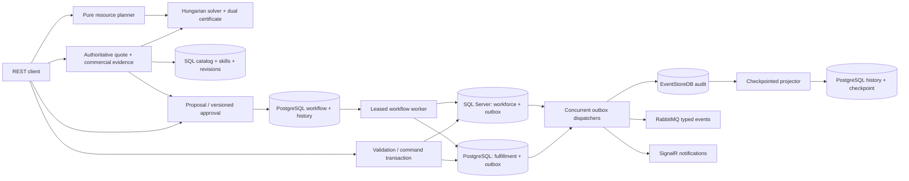

# FusionOps

**Explainable resource planning and reliable reservation in C# / .NET 10.**

FusionOps answers two operations questions: **which feasible assignment costs least, and how does an approved reservation survive concurrent requests and partial infrastructure failure?** It combines an optimal assignment solver with a durable reservation saga, two database boundaries, transactional event delivery and replayable audit projections.

Проект для демонстрации архитектурной работы на C#: алгоритмы, конкуренция, границы транзакций, восстановление после сбоев и проверяемые гарантии. Заявленные возможности подтверждаются исполняемыми тестами.

## What to inspect first

| Capability | Engineering evidence |
| --- | --- |
| Optimal, explainable assignment | Rectangular Hungarian solver; forbidden edges; skill/calendar/type constraints; primal/dual objective; 300 seeded cases checked against exhaustive search |
| Authoritative commercial planning | Persisted versioned catalog and skills; immutable database quotes; exact reviewed price; atomic acceptance checks revision, calendar, expiry and one-time consumption |
| Concurrent reservation | Transaction starts before the decision; empty-calendar range locks; sorted lock acquisition; conflict response 409 |
| Safe HTTP retries | Durable actor/operation-scoped idempotency receipts; canonical command fingerprint; original response replay; state/outbox/receipt share a commit |
| Approved cross-store reservation | Immutable proposals, ETag/If-Match approval, separate production approver, resource + license saga and ownership-preserving compensation |
| Worker crash recovery | Short SKIP LOCKED claims, database-clock lease tokens/epochs, durable success and rejection decisions, saved unresolved step and operator resume |
| Atomic integration events | State + original event identity persisted in the owning database transaction; no early event clearing |
| Failure recovery | Concurrent outbox workers, bounded attempts, durable exponential backoff, poison-message isolation and dead-letter state |
| Durable audit and replay | Idempotent EventStore append; PostgreSQL projection and source checkpoint commit together |
| Explicit architecture | Commands declare their database boundary; reads do not commit; cross-database writes fail explicitly |
| Reproducible verification | Public NuGet configuration, locked dependencies, full service solution, fast tests and real database integration tests |

## Run the planning demo — no Docker required

Install .NET 10 SDK, then from the repository root:

```powershell
dotnet restore FusionOps.sln --configfile NuGet.Config
dotnet run --project FusionOps.Presentation -- --DemoMode=true
```

Open `http://localhost:5121/swagger`. The demo exposes planning, health and metrics endpoints; it requires Development and starts no databases or brokers.

```powershell
$plan = Get-Content examples/specialist-plan.json -Raw
Invoke-RestMethod http://localhost:5121/api/v1/planning/preview -Method Post -ContentType application/json -Body $plan
```

The example has a general slot and a C# specialist slot. The cheapest expert is already booked. The solver assigns the available specialist to the specialist slot and the general operator to the general slot. Expected total: **USD 60 for two hours**, complete plan, matching primal and dual objective. Rejections explain the excluded candidates.

Planning previews use a caller-supplied snapshot and have no persistence side effects. Full-mode reservations require registered catalog resources. [HTTP examples](examples/fusionops.http) cover catalog registration and reservation retry behavior; [authoritative quotes](docs/authoritative-planning.md) explain the commercial workflow.

## Run reservations and audit locally

```powershell
docker compose -f docker-compose.core.yml up -d
dotnet run --project FusionOps.Presentation -- --Database:Initialize=true
# In another terminal, after migrations have completed:
dotnet run --project FusionOps.Infrastructure/Projector -- --urls=http://localhost:5122
```

The development stack contains SQL Server, PostgreSQL, RabbitMQ and EventStoreDB. Database initialization is explicitly opt-in in Development and applies migrations. Credentials in this stack are local development values. For existing databases, read [operations and migration notes](docs/operations.md) before applying scripts.

REST: `http://localhost:5121`; process liveness: `/health/live`; dependency readiness: `/health/ready`; metrics: `/metrics`. The outbox works even while HTTP requests are idle. Kafka diagnostics and CDC are optional (`Telemetry:KafkaEnabled` and `Cdc:Enabled`); the core reservation demo does not need them.

Full-mode write endpoints use role policies outside Development. Audit reads require AuditViewer or Admin. Configure the identity provider and production connection strings explicitly for a deployment.

## Demonstrate approval and compensation

With the full Development API running:

```powershell
pwsh -File examples/workflow-demo.ps1
```

The walkthrough registers catalog resources, calculates a database-backed USD 100 quote, reserves workforce in SQL Server and licenses in PostgreSQL, cancels a successful reservation, then demonstrates compensation after insufficient license capacity. Each run creates its own identifiers. The background worker progresses approved proposals without manual dispatch.

Workflow HTTP mutations require the current ETag in If-Match. Production workflow access requires both Resource.Manager and License.Manager; approval requires a different actor from the proposer. Confirmed participant rejection is retained, so a delayed worker cannot create a new reservation after compensation just because capacity became available. Ambiguous failures retry the original step and can pause for operator attention.

See [workflow operations and API contract](docs/reservation-workflows.md), [HTTP requests](examples/workflows.http) and [workflow ADR](docs/adr/015-durable-reservation-workflow.md).

## Architecture



Each command writes one database. The graph does not imply a distributed transaction. Delivery is at-least-once; downstream consumers need deduplication. See [transaction and delivery ADR](docs/adr/012-transactional-boundaries-and-delivery.md) and [assignment ADR](docs/adr/013-explainable-assignment.md) for the guarantees and tradeoffs.

Domain contains invariants and algorithms. Application defines commands, queries and transaction behavior. Infrastructure owns repositories, serialization and delivery. Presentation owns transport, identity, health and observability. Gateway is a separate GraphQL adapter; the Projector is a separately runnable process. Both are included in the solution build.

For an interview or portfolio review, follow the [ten-minute engineering walkthrough](docs/demo-walkthrough.md): optimization, safe retries, failure windows and executable evidence.

## Verify

```powershell
dotnet build FusionOps.sln -c Release --no-restore
dotnet test FusionOps.Domain.Tests -c Release --no-build --no-restore
dotnet test FusionOps.Application.Tests -c Release --no-build --no-restore
# Docker is required for this suite; containers are disposable and use random host ports:
dotnet test FusionOps.Integration.Tests -c Release --no-build --no-restore
```

The database suite applies real migrations and tests simultaneous empty-calendar reservations, atomic rollback, cross-boundary rejection, concurrent dispatch, poison events, audit retries, projection replay and actual RabbitMQ delivery with the original message ID. Workflow cases cover lost replies after participant commits, fenced stale workers, cancellation in flight, durable rejection, ownership-preserving compensation, operator resume, upgrades and the hosted HTTP worker. Fast tests cover optimality, business constraints, state-machine invariants, command behavior, HTTP planning and production authorization.

On Windows, if Docker's current context works but Testcontainers cannot find the default pipe, select its endpoint for the current shell before running the database suite:

```powershell
$env:DOCKER_HOST = docker context inspect --format '{{.Endpoints.docker.Host}}'
```

## Scope and next milestones

Implemented: single-horizon assignment, persisted resource catalog/skills, immutable authoritative quotes, atomic one-time acceptance with freshness checks, reservation conflict control, durable reservation idempotency keys, approved workforce/license saga with compensation, participant effect inbox, fenced worker claims, versioned transition history, operator resume, transactional outboxes, original typed contracts, durable audit and checkpointed allocation history.

Planned: tenant/project ownership, general broker consumer inbox, stock shipping saga, outbox replay API, multi-period scheduling, SLOs and reproducible performance reports. The legacy MassTransit saga contracts, ML experiment, performance runner and deployment/chaos manifests remain exploratory material. The legacy `FusionOps.EventStore.IntegrationTests` directory is superseded by the active reliability suite. SignalR cannot deliver to disconnected clients, and API reservation locks do not govern direct SQL writers.

New bookings require active catalog resources; public workflows derive their resources and reviewed price from persisted quotes. The catalog is currently shared: tenant and project ownership are not enforced. No throughput or production readiness claim is made without a measured report. [Source audit and delivery roadmap](docs/engineering-roadmap.md) records the gaps and acceptance criteria for the next increments.
