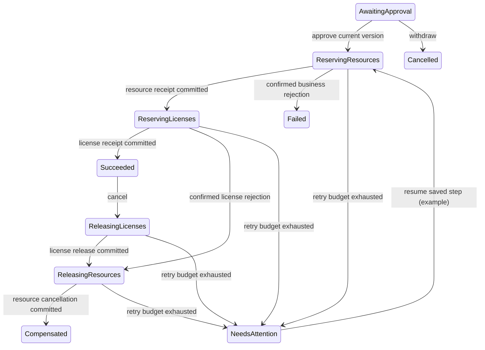

# ADR 015: approved reservations across database boundaries

Status: accepted. Date: 2026-10-13.

## Business process

A versioned proposal contains a project, a UTC period, resource IDs and license requirements. Approval starts a durable workflow: reserve workforce in SQL Server, reserve licenses in PostgreSQL, then report success. A license rejection compensates the workforce reservation. Cancellation of a successful workflow releases its own licenses before cancelling its own workforce allocations.

The proposal is immutable. Its public version changes on approval, cancellation, retries and transitions. HTTP mutation requires the version in If-Match. Production approval requires a different authenticated actor from the proposer. The complete transition history and versioned domain event commit with the coordinator state.

## Execution protocol

PostgreSQL stores coordinator state. A short claim transaction uses SKIP LOCKED and grants a bounded lease with an incrementing epoch and random token. It commits before calling a participant. Completion checks the token, epoch, unexpired database-clock lease and original step under a row lock. A stale worker cannot advance the coordinator. No coordinator lock or transaction remains open during a participant operation.

SQL Server uses its durable command receipts for resource reservation and cancellation. PostgreSQL uses an effect inbox whose receipt commits with license changes and outbox events. Stable workflow identity and step keys survive worker restarts. If a participant commits but the worker disappears before recording the transition, a fresh worker repeats that step and receives the durable original outcome. Receipt retention is indefinite in this increment.

Confirmed business rejection is a durable participant decision. Staged aggregate changes are discarded before its negative receipt commits under the same logical and calendar/pool locks. A delayed repeat still observes the rejection even if a calendar is freed or capacity increases after compensation. Transient errors do not create negative receipts. This workflow contract differs deliberately from ordinary HTTP allocation, whose failed attempts are not cached.

License ownership includes a reservation reference. Compensation releases that reference, preserving ordinary project allocations and reservations belonging to other workflows. SQL cancellation validates the returned allocation IDs, project, resources and period. Repeated compensation does not add another cancellation event.

Confirmed business rejection can initiate compensation. Transport failure, cancellation during commit and unknown exceptions cannot prove that an operation rolled back. These retry the same idempotent step; after the retry budget they enter NeedsAttention, preserving the unresolved step for an authorized resume. Deadline expiry requests compensation, but an ambiguous participant outcome must first be resolved by replay. A deadline is not a promise that compensation finishes by that instant.

## Acceptance scenarios

- Full approval, resource reservation and license reservation, across fresh scopes.
- Immutable proposal replay, conflicting submission and stale approval rejection.
- Insufficient licenses cancel workforce state without releasing another reservation.
- Crash after either participant commit, followed by safe replay from a new worker.
- Concurrent workers claim distinct work; expired claims cannot complete.
- Cancellation during an in-flight resource or license step compensates the committed outcome.
- Repeated compensation preserves event identity and produces no duplicate state change.
- Transient failures exhaust into NeedsAttention; operator resume retries the saved step.
- Deadline expiry and retry scheduling use controlled-clock tests.
- HTTP authorization, ETag/If-Match, transition history and operator read contracts.
- Changed availability cannot reverse a committed participant rejection or resurrect a compensated effect.
- The actual hosted worker progresses HTTP requests, and the decision migration preserves earlier successful receipts.

## Scope

This is a persisted orchestrated reservation saga inside the existing modular application, using database participant adapters. The effect inbox protects workflow participant operations; a general broker consumer inbox and stock shipping remain separate work. Resource catalog and tenant enforcement remain prerequisites for a public multi-tenant deployment. Planning previews still use caller snapshots; this workflow approves the selected reservation specification, not an authoritative catalog-derived cost quote. Lease expiry and cooperative cancellation require measured capacity and bounded connection/command timeouts; they do not interrupt arbitrary non-cooperative participant code.

References: [Saga pattern](https://learn.microsoft.com/en-us/azure/architecture/patterns/saga), [compensating transactions](https://learn.microsoft.com/en-us/azure/architecture/patterns/compensating-transaction), [PostgreSQL explicit locking](https://www.postgresql.org/docs/16/explicit-locking.html).
