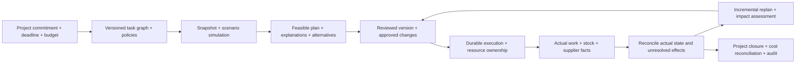

# FusionOps flagship objective: adaptive operations from commitment to closure

Status: accepted product direction, 2026-10-13. [Implementation status](flagship-delivery.md) tracks G1–G7. Current completed checks remain in [verification](verification.md); future capabilities below are not implied by the accepted objective.

The subsequently accepted [extended programme](ultimate-architecture-vision.md) retains this foundation and adds G8–G30 and fifteen research directions. The [commercial pilot analysis](commercial-pilot.md) defines a separate, unvalidated customer experiment using the same core. Neither document declares the foundation or extensions complete.

## Objective

Build a C# operations platform that takes a tenant's project commitments, deadlines and budgets; creates an explainable plan for people, equipment, inventory, licenses and suppliers; executes the approved plan across transactional boundaries; responds to actual delays and failures; and closes the project with reconciled operational and cost evidence.

The defining question becomes: **can the platform explain, execute and recover an evolving operational commitment throughout its lifecycle, while preserving ownership, approval, capacity and cost invariants?**

The target user is an organization delivering resource-intensive projects across teams, sites and warehouses. The first reference scenario is a multi-site engineering installation: specialists, equipment, parts and software licenses must be available in dependency order. Suppliers and infrastructure can fail independently. This gives the system one coherent business lifecycle and a concrete acceptance scenario.

The C# domain, planning, execution and reconciliation code is the primary portfolio artifact. An operator interface exposes those decisions and their evidence.

## Lifecycle

Planning results, operational effects and external observations have different authority. A plan proposes a future state. Approved execution acquires ownership. Observed facts confirm what actually happened. Each transition records its preconditions and source evidence.

## Eight engineering responsibilities

| Responsibility | Difficult behavior | Required evidence |
| --- | --- | --- |
| Project model | Versioned dependency DAGs, milestones, site calendars, task splitting, actual progress and scope changes | Cycle/invalid-change rejection; completed work survives revisions; deterministic graph fixtures |
| Operational model and simulation | Immutable scenario snapshots, calendar/stock/capacity revisions, supplier lead times and alternative assumptions | Scenario execution cannot reserve resources; original inputs and versions remain inspectable |
| Temporal optimization | Dependencies, simultaneous resource bundles, working calendars, maintenance/setup, skills, overtime, procurement and budget constraints | Feasibility validator independent of search; exact small-instance comparisons; quality/time and disruption reports |
| Plan authority | Immutable baselines, plan diffs, stale evidence rejection, budget/capacity ownership and versioned approval | A changed plan cannot inherit old approval; accepted effects match reviewed evidence |
| Durable execution | Long-running task lifecycles, stock movement, license reservation, procurement and uncertain external outcomes | Crashes between each commit boundary; stable effect identities; replay, compensation and forward recovery |
| Integration and reconciliation | Typed inboxes, duplicate/reordered/late events, provider adapters, schema evolution and contradictory observations | One durable consumer decision per event identity; discrepancy queue; controlled replay and correction |
| Tenant and cost authority | Project membership, approval policies, provisioning, quotas, fair admission, reserved/committed/actual cost ledgers | Ownership tests; balanced immutable postings; rejection of unauthorized approval and over-budget commitment |
| Operations and recovery | Decision inspection, unresolved-effect queues, SLOs, backup/rebuild exercises and controlled administrative changes | Reproducible load/failure reports; recovery preconditions; complete audit of operator actions |

## Planning and decision guarantees

The temporal planner must distinguish hard constraints from reviewable preferences. It must never report a plan as feasible when a mandatory dependency, exclusive resource, required skill or capacity constraint is violated. If no feasible completion exists, it returns explicit shortages/conflicts and the assumptions under which an alternative could work.

Optimization objectives are versioned and ordered explicitly: commitment/deadline priorities, cost, and disruption to already approved work. A cheaper plan does not silently release a commitment or revise an approved budget. The policy defines which changes require human review.

Persist the input manifest, source revisions, rule version, solver version, deterministic tie-breaking/seed where applicable, time budget, resulting plan, validator outcome and reported quality evidence. Historical decision replay is a read/simulation operation; it cannot issue operational effects. Claim optimality only when the chosen model and available proof justify it. Larger bounded runs may return a validated incumbent and measured quality evidence.

Cross-store planning snapshots carry their observed revisions and freshness. They do not imply an atomic transaction across SQL Server, PostgreSQL and external providers. Acceptance rechecks participant authority and reserves against current state. A stale scenario must be recalculated or durably rejected.

Rules initially use a bounded, versioned declarative vocabulary. Tenant configuration cannot execute arbitrary in-process C# code. Rule evaluation has explicit input, time/size limits and an inspectable outcome.

## Execution and accounting guarantees

Extend the existing reservation saga into project execution, preserving one transaction per owning store. A task start requires its dependencies and approved resource bundle. Its state machine must represent pending, running, completed, rejected and unresolved effects without inferring success from a timeout.

Reversible reservations can be compensated. Shipped goods, completed work and a supplier's irreversible confirmation require forward recovery and reconciliation. An adapter's contract records whether the provider supports idempotent commands; an unknown response cannot justify blindly repeating an irreversible operation.

Track the provenance of every inventory movement and resource/cost commitment. Reserved, committed and actual quantities/amounts are distinct. Internal cost postings are immutable and balanced, with explicit reversals/corrections, currency boundaries and links to the operational effect. This is project cost reconciliation; statutory accounting and taxation are outside this first product boundary.

Inbound observations keep event identity, source/version, observed time, effective time and ownership. A late fact can change the current operational assessment while preserving what was known when an earlier decision was approved. Contradictory observations enter reconciliation rather than overwriting history silently.

## Reference acceptance scenario

1. Two tenants submit projects using the same product/SKU names and independent people, equipment, stock, budgets and policies.
2. One project contains dependent design, assembly, delivery and installation tasks across sites; installation needs a specialist, equipment, parts and a license simultaneously.
3. The platform calculates alternatives, explains a constrained/shortage result, and persists a feasible reviewed baseline with cost and source revisions.
4. An authorized separate approver approves the exact plan version. A competing booking or changed inventory invalidates stale acceptance without producing partial unauthorized effects.
5. Execution commits resource ownership, stock/procurement effects and cost commitments through durable participants. A worker dies after a participant commit and resumes the original outcome.
6. A supplier reports a delay and equipment becomes unavailable. Duplicate and reordered notifications produce one durable interpretation per source event.
7. Incremental replanning preserves completed work and retained commitments, exposes changed dates/costs and requests approval where policy requires it.
8. The broker and one command store become unavailable. Unresolved outcomes remain inspectable; recovery does not duplicate shipment, resource ownership or cost posting.
9. An operator reconciles an ambiguous external confirmation using a preconditioned, audited action. Stale administrative commands are rejected.
10. The project completes and closes with reconciled quantities, cost postings, resource releases, decision history and source evidence.
11. Another tenant continues operating during the incident and cannot inspect or mutate the affected tenant's records, decisions or notification streams.
12. A fresh environment rebuilds supported projections from retained evidence. The documented recovery exercise checks ownership, ledger totals and unresolved effects against the pre-failure state.

The demonstration is scripted and reproducible, with fixed business fixtures and selectable fault points. Providers begin as deterministic protocol simulators; they still use real durable boundaries and explicitly modeled irreversible effects. Claims about real supplier systems require separately tested adapters.

## Delivery sequence

| Milestone | Shippable result | Exit gate |
| --- | --- | --- |
| G1: Project commitments | Tenant-owned versioned task DAG, milestones, calendars and invariant-preserving changes | Real HTTP/persistence contract; DAG/property tests; project authorization |
| G2: Temporal planning | Bounded multi-period scheduler, independent feasibility validation and persisted scenario evidence | Exact small-instance baseline; constrained examples; bounded cancellation; documented model/quality limits |
| G3: Approved execution baseline | Plan diffs/approval, current-state acceptance and lifecycle linked to stable participant effects | Stale-plan races; reviewed-version binding; cross-store crash/recovery scenarios |
| G4: Materials and suppliers | Inventory movement ledger, procurement state machine, typed consumer inbox and reconciliation | Duplicate/reordered input; irreversible-effect ambiguity; quantity conservation and forward recovery |
| G5: Adaptive operations | Actual progress/facts, incremental replan, impact review and internal cost reconciliation | Completed work preserved; changed commitments explicitly approved; balanced correction/replay |
| G6: Tenant operating model | Provisioning, project policies, quotas and fair admission with bounded work | Adversarial ownership/approval tests; overload and noisy-neighbor experiments |
| G7: Operational proof | Operator workflows, reproducible benchmarks, failure lab and backup/rebuild runbook | Published datasets/hardware/limits, latency/throughput, recovery traces and exercised restore |

G1 provides the authoritative project/task model. G2 extends it with retained temporal scenario evidence and bounded validated scheduling. G3 is the next execution boundary: review/approval, participant acceptance and durable task lifecycle. [Delivery status](flagship-delivery.md) records completed checks and remaining responsibilities.

Introduce service/process separation where ownership, resource isolation or measured scaling requires it. The initial implementation can retain coherent modules and the existing stores. Partitioning/cells or additional transports require a demonstrated limit, a routing/ownership protocol and a recovery test.

## Definition of flagship completion

The reference lifecycle runs from a clean clone and through the documented fault points. Every advertised invariant has executable evidence. The architecture records its trust boundaries, consistency model, irreversible effects and upgrade/restore behavior. Performance targets are set against a published workload and environment, then measured; no unexplained scale claim substitutes for that report.

Current foundation includes explainable assignment, authoritative catalog quotes, durable allocation retries, approved workforce/license saga, fenced recovery, transactional delivery, tenant row security, audit projection and versioned project authority. G2 adds bounded temporal scenarios and replay with independent validation. See [verification](verification.md) for current counts and published evidence. Approved temporal execution, inventory/procurement, adaptive planning, cost ledger, tenant capacity controls and operational proof remain later milestones.

See the [engineering roadmap](engineering-roadmap.md), [workflow protocol](reservation-workflows.md), [tenant authority](tenant-isolation.md) and [ADRs](adr).
