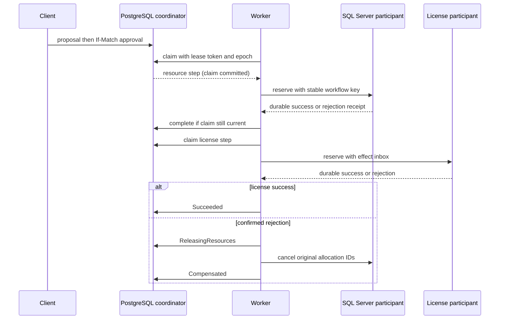

# Approved reservation workflows

A reservation proposal combines workforce resources and software licenses. The proposal itself has no reservation side effects. Approval authorizes a saga that commits one database boundary at a time and compensates confirmed business failures.

## Run the complete demonstration

Start the full Development API with migrations as described in the README, then:

```powershell
pwsh -File examples/workflow-demo.ps1
```

The script creates unique project/resource/workflow IDs and development license pools. It demonstrates successful reservation, cancellation with release, and insufficient-license compensation. Records remain available for inspection. The API worker runs by default; `Workflows:WorkerEnabled=false` disables execution while preserving proposal and operator endpoints.

The [HTTP requests](../examples/workflows.http) expose each operation separately. In production all workflow routes require both Resource.Manager and License.Manager. Approval also requires an authenticated actor different from the proposer. Development permits one anonymous actor for the local walkthrough. This is operational role authorization; catalog ownership and tenant isolation remain separate milestones.

## Contract

| Route | Result |
| --- | --- |
| POST /api/v1/workflows | 201 and ETag; immutable proposal ID is caller supplied |
| GET /api/v1/workflows/{id} | Current state, ETag, specification, original allocation IDs and ordered transition history |
| GET /api/v1/workflows?state=NeedsAttention&limit=20 | Operator queue; limit is bounded to 100 |
| POST /api/v1/workflows/{id}/approve | 202 after approval of the current version |
| POST /api/v1/workflows/{id}/cancel | 202 after durable cancellation intent |
| POST /api/v1/workflows/{id}/resume | 202 after resuming the saved unresolved step |

Mutation requires one strong quoted numeric ETag in If-Match. A missing condition returns 428, malformed input 400 and a stale version 412. A same-ID/same-proposer/same-specification submission returns the persisted current proposal. Changed meaning or proposer under the same ID returns 409. A lost mutation response is resolved by GET and its new version; approval is never silently repeated against a different reviewed version.

Public proposals take workflowId, quoteId, licenses and completionTimeoutSeconds. The stored authoritative quote supplies project, period, resources and reviewed workforce price; its identity/digest enter the specification hash. Quote acceptance checks metadata revisions, calendar, expiry and one-time consumption at the SQL commit boundary. See [catalog and quote contract](authoritative-planning.md). Existing unquoted workflows remain recoverable, but the public API requires a quote.

The specification canonicalizes resource and product order and UTC-equivalent times. It permits up to 20 distinct license products, positive bounded seat quantities and a 30–3600 second completion window. Quote expiry and workflow completion deadline are separate: approval can succeed but later acceptance can reject an expired quote.

## Execution and recovery



Claim transactions use SKIP LOCKED and commit before participant calls. The 45-second lease uses the database clock; participant attempts are bounded to 20 seconds. Each claim increments an epoch. Completion requires matching epoch, token, step and an unexpired lease under the row lock. Worker loss leaves the step available after lease expiry. A stale worker's completion cannot overwrite the coordinator.

Each participant retains its own result. Resource state/outbox/receipt commit together in SQL Server. License state/outbox/effect inbox commit together in PostgreSQL. Confirmed business rejections are durable decisions too: increased capacity or a freed calendar cannot turn a late replay into a new effect after the saga has compensated. Transient and unknown exceptions do not create a rejected decision.

Compensation uses only the original allocation IDs and workflow-owned license reference. It cannot release ordinary project license allocations or another workflow's seats. Repeating successful compensation, or replaying an old reservation after release, returns its original receipt without recreating an effect.

Cancellation during a leased step preserves that step until its result is resolved. If it committed, compensation consumes its receipt. Deadline expiry follows the same rule. It bounds the time allowed to become successful, not the duration of recovery. Ambiguous failure never proves rollback.

Retries wait 2, 4, 8 and 16 seconds before the fifth unresolved attempt enters NeedsAttention. Compensation is also retryable and can require operator intervention. Resume retries the saved step with the original specification and stable keys. It does not restart the saga or bypass a durable rejection. To attempt a new reservation after a business rejection, submit a new workflow ID.

## Inspect persisted evidence

Every business transition increments Version and commits transition history plus a ReservationWorkflowChanged outbox event. Claim metadata is infrastructure state and does not increment the reviewed version. Read endpoints use a repeatable-read snapshot so the specification, state and split-query history belong to one database snapshot.

The workflow meter exports step count by step/outcome, rejected stale completions by step and step duration. IDs belong in trace/log correlation, not metric labels. Example operator query:

```sql
SELECT "Id", "State", "Outcome", "Version", "PausedStep", "StepAttempts", "NextAttemptAt", "FailureCode", "LastErrorCode"
FROM reservation_workflows
WHERE "State" = 'NeedsAttention'
ORDER BY "UpdatedAt";
```

Read `workflow_transitions` for the cause and actor, `workflow_effect_inbox` for the participant decision, and SQL CommandReceipts for the original resource response. Receipt retention is indefinite. Do not delete receipts or alter participant-owned rows to force replay. Correct the underlying outage, resume with the current ETag, and let the original step resolve its recorded outcome.

The additive fulfillment migrations introduce coordinator, history and inbox tables plus nullable license reservation ownership. The decision migration marks earlier inbox rows as successful before enabling negative decisions. Readiness checks include workflow and receipt schemas. Review upgrades and take backups; rollback of these migrations discards recovery evidence and is unsuitable for active sagas.

The [ADR](adr/015-durable-reservation-workflow.md) records the protocol and scope. Stock shipment, tenant ownership, general RabbitMQ consumer deduplication, bounded retention and measured capacity remain future increments.
